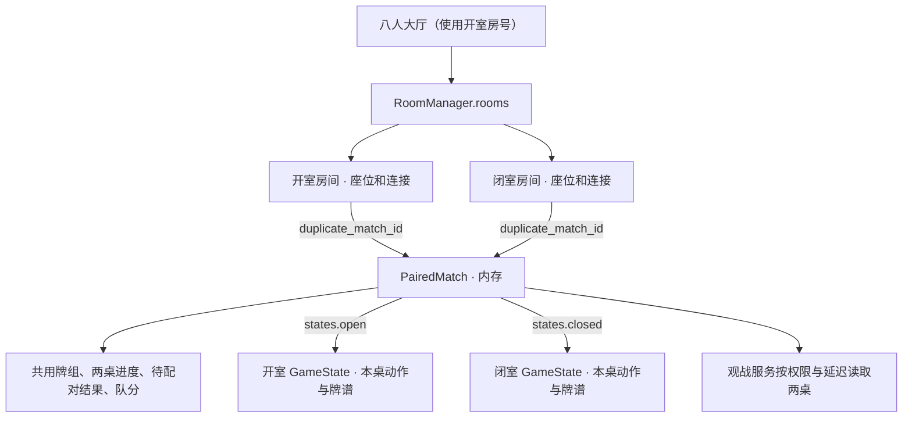
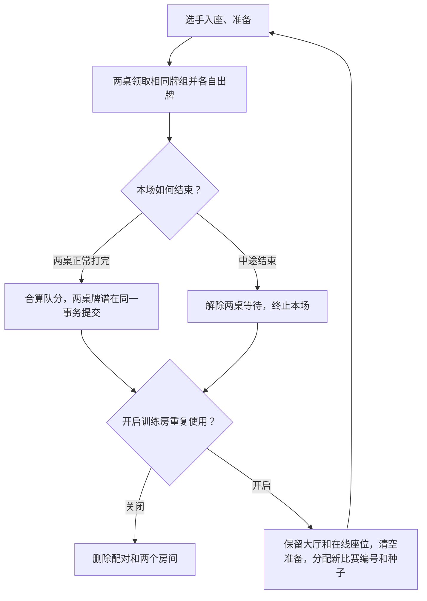

# 川麻 2V2 复式：血战与血流

实现日期：2026-10-11。独立子规则覆盖成对建房、固定座位、两桌同牌、逐副同步、计分、牌谱隔离及整组清理。普通四人房间布局保持原样。

## 规则依据与平台补充

血战依据用户提供的《四川麻将（SBR）竞赛规则（试行2025版）》第 39–47 页及其母规则。仓库的[同内容 PDF](../../other/rule/MIL_rule/四川麻将（SBR）竞赛规则（试行2025版）%20(1).pdf)与下载目录 `(3).pdf` 的 SHA256 一致。文档内容仅作为业务规则资料。

血流沿用平台血流双打的桌内行为，并扩展为两桌对应起手和牌墙相同、跨桌合分、逐副累计及平分加副的独立复式子规则。

血流按 2026-10-12 用户提供的 JJ 图示及确认使用 **每人 8 张固定墙，加 24 张公共墙**。任意一家固定墙摸空，立即把其余固定墙按东、南、西、北整段拼到公共墙前方，此后所有人摸公共墙。牌墙策略为 `fixed8_then_common_ESWN`，当前规则快照为增加双重计分后的 `xueliu-duplicate-v3`；历史 v1 牌谱按原独立墙回放。

两种复式每家 13 张起手，庄家从本家墙头多摸一张；东南西北固定轮庄。血战保持每家 14 张待摸墙的现有约定（SBR 补充细则未明确该数值）；血流使用 8 张固定墙及公共墙。两者各共 108 张数牌，每种四张。

## 子规则与差异

| 项目 | 血战双打复式 | 血流双打复式 |
| --- | --- | --- |
| 标识 | `sichuan/doubles_duplicate` | `sichuan/xueliu_doubles_duplicate` |
| 默认副数 | 8 | 16 |
| 开局 | 不换三张、不定缺 | 沿用分两批的对家换三张，然后同时定缺 |
| 摸牌 | 优先本家；本家空且对家已和，才接摸对家的剩余墙 | 先摸本家 8 张固定墙，一家摸空即转公共墙；和后不退场 |
| 杠补 | 实际可摸牌墙的墙头；无补牌不能开杠 | 固定墙或公共墙的墙头；无补牌不能开杠 |
| 待机 | 仍可碰、和；已和对家的墙重新可用时恢复摸牌 | 不单家待机，公共墙摸尽结束 |
| 和牌与收付 | 必须缺门；个人收付含队友，团队内转分抵消 | 控猪、队友不转分；沿用血流和后继续玩法 |
| 和后开杠 | 和后退场 | 杠后听口必须包含已经和过的所有牌；暗杠、加杠必须由本次摸牌构成；明杠可以接别人的牌 |
| 和后接炮 | 不再参与 | 敌方牌必和，队友牌可选择 |
| 提前结束 | 同队两人最先和；一炮多响完整处理后判断；其余不查叫、查猪 | 不因同队先和结束 |
| 主动花猪 | 个人扣 12 副分，两名对手各加 6 分（含已和牌的对手），队友不参与；个人、队伍、结算消息与牌谱同步入账，复式汇总不再重复追加队伍调整分 | 沿用血流双打既有结算 |
| 整场成绩 | 每副副差分换算 SBR IMP 后累计，同时保留副分 | 每副正副差分封顶 80 后累计，同时换算并累计 JJ IMP；默认按副分判定 |
| 全场同分 | 平局 | 两桌同时追加一副，直至分出胜负 |

两种规则均保留每副两桌的原始队分、处罚调整和副差分。配置可选 1、4、8、12、16 副；血流加赛不受 16 副上限限制。

## 创建、分队和房间

普通玩家的创建面板可看到两个子规则，选择后显示“该房间只能在比赛场的管理后台创建”，创建按钮禁用。服务端独立拒绝普通建房请求，不能靠改请求绕过。

比赛场管理员在原“创建房间”弹窗选择四川及对应子规则。数量按“组”显示，一组同时创建开室、闭室两间房；预览显示固定风位与红蓝队。默认后台隐藏生成牌墙；血流还可输入本赛事已有血流牌山的密钥（手动、种子、随机密钥均可），一份牌山只绑定一组开闭室，副数沿用牌山定义。基地、普通四人自动组桌、普通匹配不生成这两种比赛。

| 风位 | 开室 | 闭室 |
| --- | --- | --- |
| 东、西 | 蓝队 | 红队 |
| 南、北 | 红队 | 蓝队 |

每队四名选手，两室各两名。八席必须是八个不同真人账号。房间仍是四列，原分队下拉框在复式中显示“东 · 蓝队”等四个风位：玩家可移到空位，房主可交换两人的座位，队色始终绑定既定风位。准备状态与阵容版本随调整失效，开局后锁定。

两室房主分别按原“开始游戏”按钮。服务器重新验证人数、准备状态、阵容版本和两室房主在线状态；两个对局状态都准备成功后才一起发牌。一室已就绪时显示等待另一室。任何一桌准备失败会停止整组，不发出单桌独立开局。

Web 房间阅览中，两张卡片置于同一浅色叠底，固定显示开室在前、闭室在后；手机宽度下在同一叠底内上下排列。Unity 列表按关联 ID 相邻排序，复用卡片叠底显示同组颜色。删除任一室会删除整组，任一桌仍在游戏或组桌时拒绝删除。

## 同牌、同步与计分

服务端保存每副的四家起手、四段牌墙与庄位。两桌复制同一牌组后分别消费，动作差异不会改变另一室的墙。牌墙绑定原始风位，不按轮庄重新洗牌或洗座。

同步模式下，两桌均完成本副结算和准备后开放下一副。默认的非同步模式允许一桌先进行下一副，最后一副等待两桌结算。玩家在同一服务进程内断线重连时从本室恢复。

蓝队当副副差分 = 开室蓝队副分 + 闭室蓝队副分。红队为相反数；两队分别将正数计入成绩、非正数记 0。不能再减一次对方队分，否则会翻倍。

血战的 IMP 对照：0→0，1–2→1，3–5→2，6–8→3，9–11→4，12–15→5，16–19→6，20–25→7，26–31→8，32–39→9，40 以上→10。逐副换算，再累加。

血流按用户 2026-10-12 补充同时记录小分和大分：小分为两桌合并后的正副差分，单副封顶 80；JJ IMP 为 0→0、1–9→1、10–29→2、30–59→3、60 以上→4。两套成绩均逐副处理后累计，不能先截断单桌分数，也不能将整场合计分差一次换算。原始有符号分差另存，不因封顶丢失。开室红队 +100、闭室蓝队 +10，红队得 80 副分和 4 IMP；闭室蓝队 +40 时，红队得 60 副分和 4 IMP。

目前血流胜负仍按小分累计，记录 IMP 不改变平分加副的判断。用户材料只提到存在 KO，未给出触发条件，本次未增设提前终止规则。已保存 v1/v2 比赛沿用快照中的原计分方式，不追溯修改历史胜负；旧客户端可继续读取原 `scores` 字段。

示例：开室蓝队 +18、闭室蓝队 −10，蓝队副差分为 +8。该副血战得 3 IMP，血流得 8 副分和 1 IMP；红队本副得 0。

客户端最终同时显示个人分数、全队副分与 IMP，全队成绩含开闭两室；胜负依据单独标明。公开数据站保留逐副开闭室分数、原始差分、副分、IMP 和两套累计成绩。

## 房间生命周期和牌谱

每组有一个内存中的 `PairedMatch`。它持有开室和闭室的两个 GameState 引用、共用牌组、八人阵容、每桌已完成的副数和跨桌成绩。每桌保留自己的行动记录。逐副提交按桌号、副号和摘要去重。

正常完赛时，两桌正式牌谱在同一个数据库事务中发布。开室、闭室和配对实例在最后一桌清理时移除。提前结束同样关闭整组。服务重启后，新旧复式房间都不会恢复，已提交的牌谱可按原权限查看。

训练牌山默认使用玩家输入或生成的种子。选择“重复使用”后由服务端为每场分配新种子和比赛编号，保留大厅与在线座位并清空准备状态，从第一副开始。赛事训练房可以空置，个人房最后一名真人离开后解散。

正式密钥使用 `duplicate_walls` 管理资产和额度。解锁时，管理端查询游戏服内存中使用该牌山的比赛。正常完赛后才写入两桌的 `duplicate_games` 牌谱关联。训练房无需密钥或配额。旧表 `sichuan_duplicate_matches` 用于历史牌谱兼容；升级时会把旧密钥的原定副数补到牌山资产上。此后用旧密钥开新房也只读取牌山资产。进行中的阵容、同步进度和中间牌谱都在内存。

### 运行时数据结构

### 从开局到清理

## 核心实现位置

- `server/game_calculation/sichuan/duplicate_rules.py`：规则快照、108 张牌组、IMP 与副差分。
- `server/gamestate/game_sichuan/duplicate_wall.py`、`DuplicateGameState.py`：分座位墙与两种桌内状态机接入。
- `server/gamestate/public/sichuan_duplicate.py`：两桌开始／副结束同步、去重和整场成绩。
- `server/room/sichuan_duplicate.py`、`server/database/sichuan_duplicate.py`：成对房间的创建与清理、训练房复用、正式密钥关联。
- Web：`VenueRoomDialog.vue`、`EventRoomCards.vue`、`DuplicateData.vue`。
- Unity：`SichuanLobby.cs`、`RoomPanel.Doubles.cs`、`SimpleRoundPanel.cs`、`EndGamePanel.cs`；沿用现有布局。

测试包括规则边界、待机与接摸、双桌屏障、八客户端完整对局、计分及牌谱跳转、权限与解锁、失败回滚、中断清理，以及 Unity/Web 实际画面检查。具体运行次数、覆盖率和截图保存在本机忽略目录，不作为面向其他使用者的工具提交。
