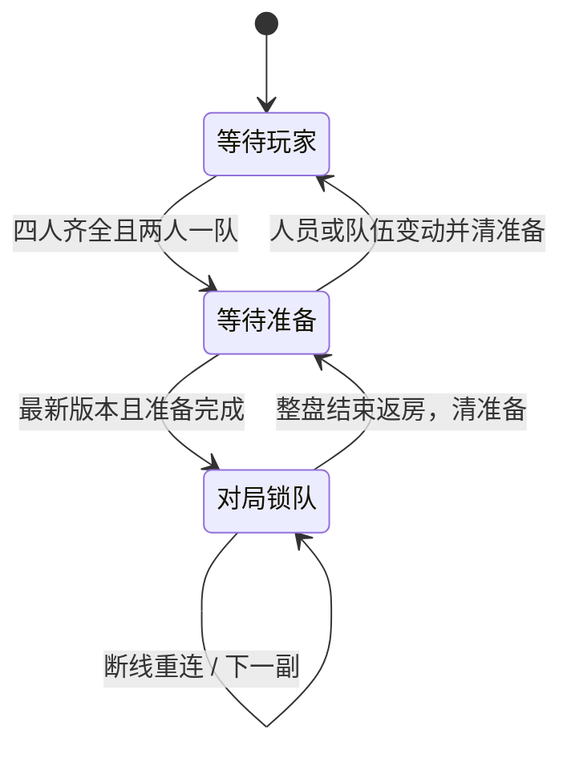

# 血战双打·2V2

## 范围与规则依据

新增子规则 `sichuan/doubles`，沿用四川麻将的四人血战引擎，提供同桌四人、两人一队的普通双打。创建房间时选择“血战双打·2V2”。自定义房和赛事房配置均可使用；本次不实现两桌八人的复式双打、复制牌墙、双人匹配队列或队伍段位。

规则依据为用户提供的《四川麻将（SBR）竞赛规则（试行2025版）》第 39—42 页双打条款。下面明确区分书面规则和为补齐线上流程采用的平台约定。`sichuan/standard`、两种血流子规则继续保持各自规则。

## 牌局与胜负

| 项目 | 双打行为 |
| --- | --- |
| 基本流程 | 四人同桌，开局队友坐对家，团队关系整盘固定；原有圈数对应 4 / 8 / 12 / 16 副 |
| 定缺 | 不进行定缺，也不受定缺花色优先打出限制 |
| 和牌、听牌 | 手牌与副露合起来仍须缺一门；暗杠同样计入花色判断 |
| 顺和 | 关闭；放过一次和牌不会触发顺和限制 |
| 基础计分 | 零番起和、血战到底；复用现有 SBR 番型、杠分和逐人收付 |
| 队友关系 | 可以碰、杠、和队友打出的牌，也按个人原规则收付；队内收付在团队合分时自然抵消 |
| 普通结束 | 三家和牌或牌墙耗尽，按既有血战流程处理 |
| 同队先和 | 最先和牌的两人同队时提前结束。先处理完整的一炮多响窗口，不能截断同时有权和牌的第三人 |
| 提前结束结算 | 结清已有和牌和杠分；余下两人免查叫、花猪处理和因未听牌导致的退税 |
| 盘胜负 | 整盘个人副分按队相加，较高队获得 1 盘分，另一队 0 盘分 |
| 总分相同 | 倒查最后一副团队得分不同的牌，正分队作为追平队获胜；末尾相同副分的副不影响追平判断 |

### 牌墙耗尽时的花猪

花猪按最终手牌与副露合计是否三门判断。判断弃牌花色时使用实际打出的原始弃牌历史，不能因为河牌被碰走就改变结果。

- 只打出一种花色的花猪为被动花猪：按未听牌处理，不扣主动花猪罚分。
- 打出过多种花色的花猪为主动花猪：扣 24 副分，并按未听牌处理查叫及相关退税。
- 同队先和结束时不执行以上流局处理。

### 明确记录的平台约定

规则书未完整覆盖以下边界，因此使用固定约定，并写入牌谱的 `doubles_rule_profile`：

1. 从未弃牌而以三门结束的玩家，按被动花猪处理。
2. 整盘完全打平，或者最后一副不平分但没有可唯一判定的正分队时，判平局，双方各 0.5 盘分。
3. 规则版本为 `sbr2025-doubles-v1`。未来改变上述约定须升级版本，旧牌谱以记录内容为准。

## 房间与分队

### 保持原房间布局

继续使用原四列玩家卡片、右侧规则列表和底部操作区。四张卡片的位置与尺寸、玩家名、准备标记、添加/移除机器人入口、开始/离开按钮不移动。卡片内保留“未分队 / A 队 / B 队”选择框，复用原有下拉框字体与样式，A 队蓝色、B 队红色。房间不增加分队注释、随机分队功能或双打规则说明行。

牌桌将玩家 ID 下原有底板染成队伍蓝/红色，不额外增加方块或占用定缺位置；SBR 双打依规则书不进行定缺。结算保持四行玩家布局，在每行显示个人副分、团队总分与盘分，并按团队显示胜/负/平。

候选张提示保留可补成基本和牌结构的牌；手牌与副露合计仍有三门花色时，显示红色“需缺门”。碰、明杠、暗杠均计入花色，七对同样需要缺门。实际和牌与查叫仍按缺门条件校验。

### 权限与生命周期

| 状态 / 操作 | 处理 |
| --- | --- |
| 加入或添加机器人 | 自动分配到人数较少的队，保留空座位；同类型机器人可以分属不同队 |
| 玩家选队 | 玩家只能修改自己的座位；房主可以修改任一已占座位 |
| 队伍已满 | 拒绝第三人加入；需要交换成员时先将一人设为“未分队” |
| 换队、加入、退出、踢人 | 更新阵容版本并清空真人准备状态；机器人沿用自动准备机制 |
| 开始对局 | 四席齐全、A/B 各两人、其他真人已准备、请求版本为最新，才允许开始 |
| 开局排座 | 同队成员随机分配到对家；团队身份随玩家进入牌局快照，不依赖房间列的位置 |
| 对局中 | 队伍锁定；不能通过退房重入换队；断线使用现有重连机制恢复本人座位和队伍 |
| 整盘结束返房 | 保留房间成员和队伍，清空准备并更新版本，下一盘可以重新分队 |

房主不需要准备；机器人不会因共用 `user_id` 而被合并成一个队员。队伍必须绑定“座位”，不能绑定用户 ID 字典。



## 协议与服务端实现

房间快照新增：

```json
{
  "sub_rule": "sichuan/doubles",
  "seat_list": [101, 102, 2, 2],
  "team_by_seat": [0, 1, 0, 1],
  "roster_revision": 7
}
```

`team_by_seat` 与 `seat_list` 一一对应；`0` 为 A，`1` 为 B，`-1` 为未分队/空位。服务端检查身份、房间归属、阵容版本、座位占用、队伍容量及对局状态，不相信客户端按钮是否可点。

| 请求 | 新增参数 |
| --- | --- |
| `room/set_team` | `room_id`, `roster_revision`, `seat_index`, `team_id` |
| `room/set_ready` | 双打必须携带当前 `roster_revision` |
| `room/start_game` | 双打必须携带当前 `roster_revision` |

过期或缺失版本的双打请求被拒绝，客户端以服务端广播为准。非双打房间不强制新增版本字段。赛事自动开局使用服务器当前阵容版本，并经过相同分队检查。

上线时需要同步发布服务端与支持双打的客户端；旧客户端不能完成双打的选队/准备流程，不应单独对旧客户端开放双打入口。

职责划分：

- `server/room/room_teams.py`：队伍分配、权限、版本、清准备与开局约束。
- `server/game_calculation/sichuan/doubles_rules.py`：缺门、花猪、团队合分及追平判胜纯规则。
- `SichuanGameState`：无定缺开局、对家排座、完整和牌窗口后的结束判定、每副和整盘团队结算。
- `action_check.py` / `shunhe.py` / `wait_action.py`：所有和牌途径统一校验缺门，双打关闭顺和。
- `boardcast.py`：个人可见快照、团队结果与重连同步。

新规则复用现有逐人计分账，不另造并行的团队结算账。团队分始终由成员分数汇总，避免两套账漂移。原标准血战流程只在 `is_doubles` 分支改变上述指定行为。

## 信息公开、牌谱和兼容

- 队友只能看到公开牌面；不会收到队友暗手。没有新增队内聊天或队友代操作。
- 中途和牌继续延迟结算，双打不提前向其他玩家公开未结算番型和番数。
- `game_info.sichuan_teams` 提供开局座位到队伍的映射、已结算团队分和逐副记录。客户端重连使用该权威快照。
- 牌谱 `game_title` 保存 `team_by_player_index`、规则版本和固定房规；顶层 `doubles_rounds` 保存逐副团队变化，`doubles_result` 保存整盘团队分、获胜队、判胜原因和盘分。
- 团队映射按原始玩家序号保存；回放换视角不能以用户名或重复机器人 ID 推断队伍。
- Unity 回放显示队标，同队先和结束显示“同队先和”，不再根据弃牌推测定缺。Web 牌谱详情可查看两队成员、合分、盘分和判胜原因。
- 含机器人的牌局沿用现有平台策略，仅保存本地牌谱；本功能不改变云存储和观战限制。
- 旧牌谱和普通单打房不含团队字段时，继续走原有显示及计分路径。

## 验收与测试入口

Python（在 `open_mahjong_server` 内）：

```powershell
.venv/Scripts/python.exe -m pytest server/room server/gamestate/game_sichuan server/game_calculation/sichuan server/gamestate/public/test_sichuan_record_metadata.py -q
```

新增 `test_doubles.py`、`test_doubles_room.py` 和 `test_doubles_full_match.py`，覆盖房间完整生命周期、权限及旧版本请求、同类型机器人分队、开局对家、各种和牌途径缺门、顺和关闭、主动/被动花猪、队内收付、一炮多响原子处理、提前结束豁免、追平/全平判胜、重连隐私与牌谱结果一致。整盘用三个固定种子通过真实动作路由打完 12 副，检查每副分数累加与最终结果、记录一致。

Unity Editor 验证：`SichuanDoublesValidation.Run()`、`SichuanTipsValidation.Run()`、`SichuanScoreHistoryValidation.Run()`；Play Mode 使用 `ShowAndValidateRoom()` 检查原四卡片矩形不变、分队同步和开始按钮约束。另在本地服务进行真实分队、开局、整盘和回放检查。

Web：`client/tests/sichuanDoubles.test.mjs` 覆盖赛事配置往返、重复机器人团队解析及平局，连同既有赛事配置与四川回放测试执行；使用 Vite production build 验证打包。

测试运行日志、截图和构建产物放在工作区 Git 忽略的 `.om_workspace/sbr-doubles-implementation/`；不应作为业务资源发布。
